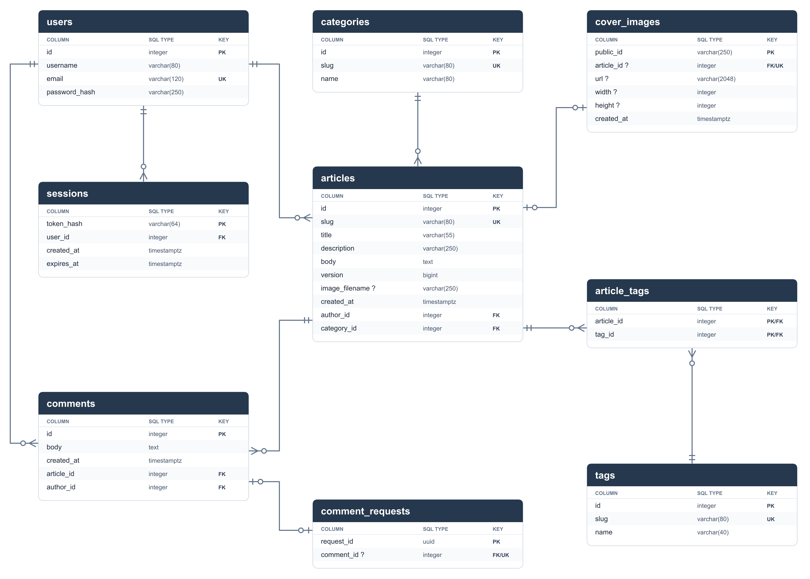

# Hummingbird 🐦

Hummingbird is a blogging application built with Angular, Express and PostgreSQL.
Readers can browse articles, while registered users can publish posts and join the discussion.

👉 [Live application](https://hummingbird.chirp.blog)

---

## ✨ Features

- Register, log in, and log out
- Create, edit, and delete your own articles with cover images
- Organize articles with categories and tags
- Search and filter articles with pagination
- Post comments and delete your own comments
- Responsive frontend

---

## 🛠 Tech Stack

- **Frontend:** Angular, TypeScript and SCSS
- **Backend:** Node.js, Express and TypeScript
- **Database:** PostgreSQL and Prisma ORM
- **Images:** Cloudinary

---

## 📁 Project Structure

```text
hummingbird/
├── client/            # Angular frontend
├── server/            # Express API, Prisma migrations and database tests
├── postman/           # API request collections
└── deploy/            # Hostinger service, HTTPS proxy and cleanup timer
```

---

## 🚀 Getting Started

### Prerequisites

- Node.js 24 (24.12.0 or newer) and npm; use nvm with the included `.nvmrc`
- A running PostgreSQL server
- Cloudinary credentials for optional cover uploads

Run these commands from the repository root:

```bash
nvm install
nvm use
npm ci
```

---

## 🔧 Environment Variables

For a fresh setup, copy the server example and fill in your local credentials:

```bash
cp server/.env.example server/.env
```

| Variable                                                               | Purpose                                                  |
| ---------------------------------------------------------------------- | -------------------------------------------------------- |
| `DATABASE_URL`                                                         | Development database                                     |
| `SHADOW_DATABASE_URL`                                                  | Separate disposable database for creating migrations     |
| `TEST_DATABASE_URL`                                                    | Separate disposable database ending in `_test`           |
| `CLOUDINARY_CLOUD_NAME`, `CLOUDINARY_API_KEY`, `CLOUDINARY_API_SECRET` | Optional cover uploads; leave all three blank to disable |

The API defaults to port `3000` in development. Keep `server/.env` private;
it is ignored by Git. The frontend connects through `/api` and contains no secrets.

---

## 🗄️ Database Setup

Create the local role and three databases using the [server setup](server/README.md#-postgresql-setup),
then apply migrations and load the sample data from the repository root:

```bash
npm run db:deploy
npm run db:seed:demo
```

Repeated seeding preserves existing content and creates no duplicates.
Demo authors cannot sign in; register your own account. For categories only,
use `npm run db:seed`.

---

## ▶️ Running the Application

Start the API from the repository root:

```bash
cd server
npm run dev
```

In another terminal, starting at the repository root:

```bash
cd client
npm start
```

Open [Hummingbird](http://127.0.0.1:4200). Use Ctrl+C in each terminal to stop.
More details: [client setup](client/README.md) · [server setup](server/README.md).

---

## ☁️ Production

Build and run both parts from the repository root:

```bash
npm ci
npm run build
npm run db:deploy
npm run db:seed
npm start
```

Configure `NODE_ENV=production`, `DATABASE_URL` and the optional Cloudinary
credentials on the host. Serve the application over HTTPS. See the
[production setup](server/README.md#-production-hosting) for proxy and cleanup settings.

---

## 🧪 Tests and Quality Checks

Run from the repository root:

```bash
npm run check --prefix client
npm run check --prefix server
npm run test:db --prefix server
```

Database tests erase their disposable `_test` database. Keep it separate from development.
Import the [Postman collections](postman/) to test the API manually.

---

## 🗂️ Data Model

Hummingbird uses PostgreSQL tables for users, articles, categories, tags and comments.
Articles and tags have a many-to-many relationship through `article_tags`.

[](docs/images/data-model.svg)

<details>
<summary>Additional indexes</summary>

| Table          | Indexed columns, in order |
| -------------- | ------------------------- |
| `articles`     | `author_id`               |
| `articles`     | `category_id`             |
| `article_tags` | `tag_id`                  |
| `comments`     | `article_id, id`          |
| `comments`     | `author_id`               |
| `cover_images` | `article_id, created_at`  |
| `sessions`     | `user_id`                 |
| `sessions`     | `expires_at`              |

Primary-key and unique indexes are represented by **PK** and **UK** in the diagram.
The two PK fields in `article_tags` form one composite primary key.

</details>

---

## 📊 Data

The demo dataset is created by a custom [seed script](server/prisma/seed.ts)
using fixed, synthetic text and timestamps from [seed-data.ts](server/prisma/seed-data.ts).

It contains:

- 2 users
- 3 articles
- 3 categories
- 3 tags
- 5 article–tag links
- 2 comments

From the repository root, run:

```bash
npm run db:seed:demo
```

Repeated runs preserve existing content and create no duplicates. No external data
or images are downloaded. Demo users cannot sign in; register your own account.

---

## 🎓 Project Context

Hummingbird was built as a university project to learn basic web technologies
and is being extended to explore relational database design and development.

---

## 🤖 Use of AI Tools

AI tools support implementation, refactoring, testing, debugging, and documentation.
The author is responsible for reviewing the code and understanding the submitted work.
